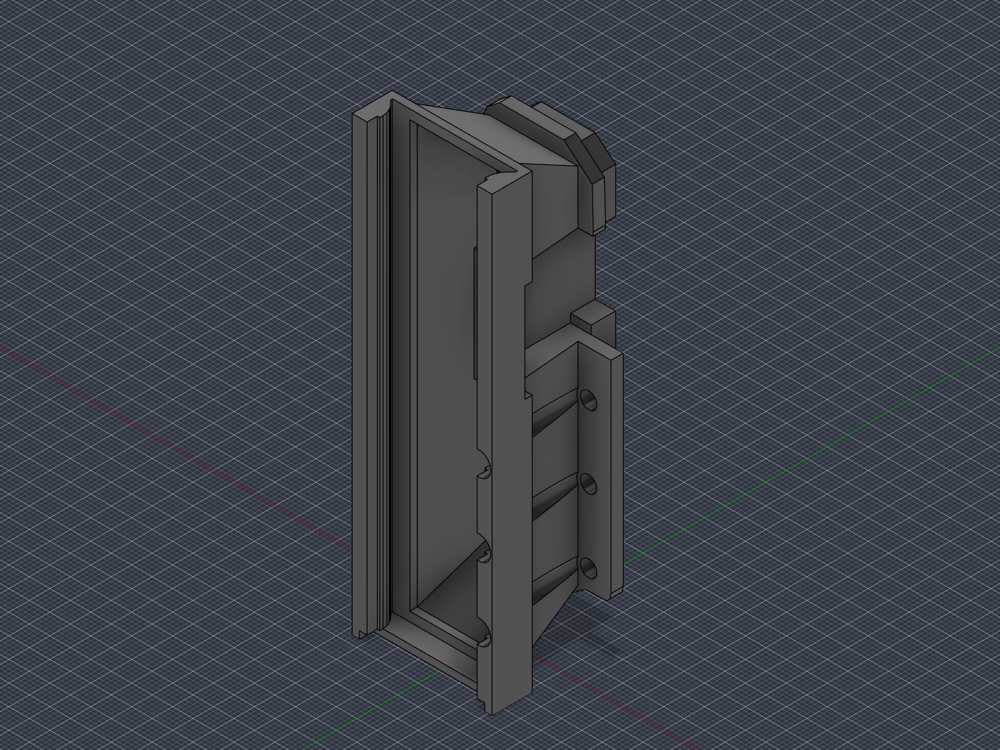

# V100 / P40 straight blower duct

A short, straight duct that screws to the heat sink end of a passive NVIDIA Tesla V100 or P40 PCIe card and holds a
slim 25 mm radial blower (SUNON EFB0251S3-C010-S9A, sold as a Lenovo S560/S562 AIO blower). The fan slides into a
dovetail slot shaped like its flared outlet, so it needs no screws.

Built for the Tesla V100 workstation in
[`recipes/Swift-1.5-IQ3_S-Strata-Single-Tesla-V100`](../../recipes/Swift-1.5-IQ3_S-Strata-Single-Tesla-V100), where it
replaces a 180-degree U-duct.

## Files

| Path | What it is |
|---|---|
| `print/v100-straight-blower-duct-P1S-PETG.3mf` | Bambu Studio project, sliced for a P1S 0.4 nozzle with Generic PETG (2 h 29 min, 36.7 g) |
| `print/v100-straight-blower-duct.stl` | the part in print orientation (mm) |
| `print/v100-straight-blower-duct.3mf` | plain 3MF of the same part |
| `cad/v100-straight-blower-duct.f3d`, `.step` | the part in Fusion 360 and STEP form |
| `cad/fusion_build_duct.py` | the parametric source: a Fusion 360 script that rebuilds the part from the dimensions at its top |
| `images/` | CAD renders |

## Key dimensions

- The fan's outlet rim sits **21.8 mm** from the card end: a 3 mm flange, a 17 mm transition and a 1.8 mm floor.
  Card end to the far edge of the fan is about **122 mm**.
- 36.5 mm thick, the full shroud height. A 6 mm nose goes into the shroud end.
- The fan slot fits an outlet that is 30 x 108 mm across its flare, 4 mm deep, on a 25 mm housing (0.3 mm clearance).
- The 8-pin plug cutout is open for the full 20 mm up to the fan, 2 mm wider than the plug on each side, with a
  45-degree ramp under the fan slot so the cables bend over a slope.

## Hardware and assembly

1. Push the nose into the card's heat sink end and fix the duct with **3 x M3** screws (about M3 x 8) into the card's
   threaded holes. The screws go in through 5.8 mm access pockets about 22 mm deep, so use a long, thin driver or
   hex key and socket head screws.
2. Plug in the 8-pin power cable and lay it through the cutout.
3. Slide the blower in from the top of the card until it stops against the end wall.
4. Wire the fan: 12 V, 3.24 W, 4-wire PWM (red +12 V, black GND, yellow tach, blue PWM).

## Printing

PETG or ASA, not PLA: the heat sink runs at 80 C and above. 0.20 mm layers, 3 walls, 15 % infill, tree supports from
the build plate only, 5 mm outer brim. It prints standing up with the closed end of the fan slot on the bed; the
files are already in that orientation.

## Status

Two fit iterations so far. The card-side shape is copied from a duct that fits these cards (see Credits). The fan
slot and the cable cutout are new and have had one test fit. No thermal comparison against the old U-duct yet.

## Credits and license

Remix of [NVidia Tesla P40 & V100 funnel for 92mm fan](https://www.printables.com/model/1839179-nvidia-tesla-p40-v100-funnel-for-92mm-fan)
by cuddly-vowed-shush: the nose, flange, screw holes and 8-pin cutout were taken from its STL.

Unlike the other models in this repository, this one is **CC BY-NC-SA 4.0**, the original's license. See
[`LICENSE-CC-BY-NC-SA-4.0.txt`](LICENSE-CC-BY-NC-SA-4.0.txt). It covers the build script too, since the script
embeds that geometry.
